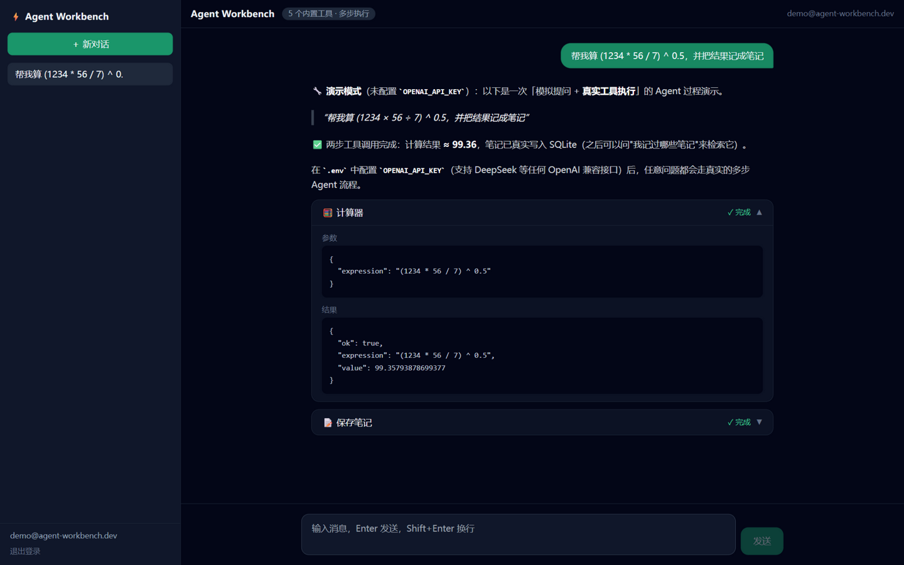

# ⚡ Agent Workbench

一个从零实现的全栈 AI Agent 工作台：**Next.js + Vercel AI SDK**，支持流式对话、多步工具调用（过程可视化）、用户认证与会话持久化。

**🚀 线上 Demo**：<https://agent-workbench.qixin-study.workers.dev>（注册即用，未配置模型 Key 时自动进入演示模式——模拟提问 + 真实工具执行）



> 定位：学习型 / 简历项目。不含任何从其他项目复制的代码，架构与实现均可逐行讲解。

## 功能

- 🔑 **用户认证**：注册 / 登录 / 登出，`bcrypt` 加盐哈希 + httpOnly Cookie 服务端会话
- 💬 **流式对话**：服务端 SSE（AI SDK Data Stream 协议），打字机式输出，可随时中断
- 🔧 **工具调用（Function Calling）**：内置 5 个工具，Agent 可多步连续调用（`maxSteps: 5`）
  - `calculator` 手写递归下降解析器求值（不依赖 `eval`，见 `src/lib/calc.ts`）
  - `get_current_time` IANA 时区时间
  - `fetch_webpage` 网页抓取 + 正文提取（8s 超时保护）
  - `save_note` / `search_notes` 笔记的写入与检索（按用户隔离）
- 👁 **过程可视化**：每次工具调用的名称、参数、运行状态、返回结果在聊天中折叠展示
- 🎬 **演示模式**：未配置 API Key 时自动播放一次「模拟提问 + 真实工具执行」的 Agent 过程（表达式真实求值、笔记真实入库），零配置访客也能看到完整产品形态
- 💾 **会话持久化**：多会话管理、历史消息（含工具调用记录）回放，SQLite 存储
- 🧪 **测试 + CI**：Vitest 单元测试，GitHub Actions 跑 类型检查 / 测试 / 构建
- 📦 **模型无关**：任何 OpenAI 兼容接口（OpenAI / DeepSeek / 通义 / Moonshot…）均可通过环境变量接入

## 技术栈

| 层 | 选型 |
| --- | --- |
| 前端 | Next.js 15 (App Router) · React 19 · TypeScript · Tailwind CSS |
| Agent | Vercel AI SDK v4（`streamText` + `tool` + `useChat`） |
| 后端 | Next.js Route Handlers（Node.js runtime） |
| 数据库 | SQLite（libSQL client，本地文件 / Turso 远程均可） |
| 认证 | bcryptjs + 服务端 Session（httpOnly Cookie） |
| 质量 | Vitest · `tsc --noEmit` · GitHub Actions CI |

## 快速开始

要求 Node.js ≥ 18.18。

```bash
npm install
cp .env.example .env   # 填入 OPENAI_API_KEY
npm run dev
```

打开 http://localhost:3000 ，注册一个账号即可开始对话。

### 环境变量

| 变量 | 必填 | 说明 |
| --- | --- | --- |
| `OPENAI_API_KEY` | ✅ | 任何 OpenAI 兼容服务的 Key |
| `OPENAI_BASE_URL` | ❌ | 例如 DeepSeek：`https://api.deepseek.com/v1` |
| `OPENAI_MODEL` | ❌ | 模型名，默认 `gpt-4o-mini`（DeepSeek 用 `deepseek-chat`） |
| `LIBSQL_URL` | ❌ | 远程 libSQL/Turso 地址；不填使用本地 `data/app.db` |
| `LIBSQL_AUTH_TOKEN` | ❌ | 远程数据库的访问令牌 |

### 常用脚本

```bash
npm run dev        # 开发服务器
npm run build      # 生产构建
npm run typecheck  # TypeScript 类型检查
npm test           # Vitest 单元测试
```

## 架构说明

```
src/
├── app/
│   ├── page.tsx                  # 落地页
│   ├── login/page.tsx            # 登录 / 注册
│   ├── chat/page.tsx             # 主界面（服务端鉴权 + 加载会话列表）
│   └── api/
│       ├── auth/{register,login,logout}/route.ts   # 认证
│       ├── chat/route.ts         # 核心：streamText + 工具 + 数据流响应
│       ├── conversations/...     # 会话 CRUD（含所有权校验）
│       └── messages/route.ts     # 对话落库（含工具调用记录）
├── components/
│   ├── ChatApp.tsx               # 聊天主容器（useChat / 会话切换 / 保存）
│   ├── Sidebar.tsx               # 会话侧边栏
│   ├── ToolCard.tsx              # 工具调用可视化卡片
│   └── LoginForm.tsx
├── lib/
│   ├── db.ts                     # libSQL 客户端 + 建表（幂等）
│   ├── auth.ts                   # 会话创建 / 销毁 / 获取当前用户
│   ├── calc.ts                   # 手写表达式解析器（tokenizer + 递归下降）
│   └── tools.ts                  # Agent 工具定义（Zod schema + execute）
└── tests/                        # Vitest 单元测试
```

一次带工具调用的请求流程：

```
浏览器 (useChat)
  → POST /api/chat {messages, conversationId}
    → 服务端校验会话 Cookie
    → streamText() 调用 LLM，模型决定调用工具
      → 本地执行工具（计算/抓取/读写 SQLite）
      → 工具结果回传模型，继续生成（最多 5 步）
    → 以 Data Stream 协议流式返回
  ← 前端逐步渲染文本 + ToolCard
  ← onFinish 后 POST /api/messages 将对话与工具记录落库
```

## 部署

- **Cloudflare Workers（当前线上方案）**：OpenNext 适配 + Cloudflare D1 数据库。数据库层做了双实现（`src/lib/db.ts`：D1 / libSQL 同一接口），一条命令部署：
  ```bash
  npx wrangler d1 create agent-workbench   # 把返回的 database_id 填入 wrangler.jsonc
  npm run deploy
  ```
- **Node 自托管**：`npm run build && npm start`，本地 SQLite 文件即可工作。
- **Vercel**：导入仓库 + 配置远程 `LIBSQL_URL`（[Turso](https://turso.tech) 免费档）亦可。

## 简历可以这样写（示例）

- 独立设计并实现全栈 AI Agent 应用（Next.js 15 / TypeScript / SQLite），支持流式对话、多步工具调用与会话持久化
- 基于 Vercel AI SDK 实现服务端流式输出（SSE）与 Function Calling 多步执行循环，工具调用过程在 UI 全程可视化
- 手写表达式解析器替代 `eval` 实现安全计算工具；实现 httpOnly Cookie 服务端会话与 bcrypt 密码哈希
- 为核心模块编写单元测试并搭建 GitHub Actions CI（类型检查 / 测试 / 构建三道门禁）
- 部署至 Cloudflare Workers（OpenNext 适配 + D1 数据库），数据库层实现 D1 / libSQL 双后端统一接口，本地与云端同一套业务代码

## Roadmap

- [ ] RAG：文档上传 + 向量检索，作为新的 Agent 工具
- [ ] 流式输出中断恢复（resume）
- [ ] 更多工具：代码执行沙箱、多 Agent 协作编排
- [ ] Lighthouse 性能优化与可访问性改造（用前后数据说话）

## License

MIT
